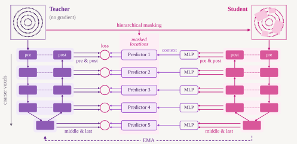

<div style="text-align: center; margin-bottom: 1em;">
<h1>TL;DR</h1>
<p style="font-weight: 500; width: min(90%, 760px); margin: 0 auto;">
J3PA learns robust and descriptive representations from only raw unlabeled LiDAR point clouds. Trained at scale J3PA-1B outperforms state-of-the-art self-supervised methods and a fully supervised PTv3 under linear probing. We distill J3PA-1B into Large (135M) and Small (42M) models that trade accuracy for speed by changing the voxel size.
</p>
</div>

<div class="j3pa-plots"></div>

<include-html src="plots.html" />

# Robust and consistent features
<!-- Videos are <data-dir>/<sequence>_s<stage>.mp4 with stage 0..data-stages-1 (shown as S1..Sn). Add sequences to data-sequences to get more arrow pages. data-variants (optional) adds top-left buttons for alternative video sets; "stages" lists which exist (omit when all do). -->
<div class="j3pa-stage-player" data-variants='[{"name": "Aggregate", "dir": "https://huggingface.co/datasets/paunas/j3pa-web/resolve/main/videos_map_agg_web"}, {"name": "Fade", "dir": "https://huggingface.co/datasets/paunas/j3pa-web/resolve/main/videos_map_web"}]' data-sequences="000168" data-stages="5"></div>

<div class="j3pa-stage-player" data-dir="https://huggingface.co/datasets/paunas/j3pa-web/resolve/main/videos_front_web" data-sequences="001114,001096" data-stages="5"></div>

<include-html src="stage-video.html" />

# Abstract
Learning versatile representations from unlabelled LiDAR point clouds is crucial for systems that perceive and interact with physical environments. While joint-embedding predictive architectures (JEPAs) have had great success in images and video, prior work on self-supervised learning (SSL) for point clouds has largely focused on invariance-based methods. We address positional information leakage when adapting JEPA for point clouds and introduce a sparse deformable attention layer to build a leakage-free predictor. To improve SSL at scale, we modify existing convolution-transformer hybrid encoder architectures into a pure transformer and train it on a combined corpus of outdoor point clouds. The resulting model, J3PA (Joint 3D-embedding Predictive Architecture), learns robust representations only from raw unlabeled point clouds without other modalities. Our largest model, J3PA-1B, is distilled into two variants, Large and Small with approximately 135M and 42M parameters respectively. Under linear probing, J3PA-1B markedly outperforms state of the art SSL methods and a fully supervised PTv3 across a large set of tasks and datasets, including a dataset unseen during training. We introduce a distillation procedure parametric in the voxel size to obtain models that are highly adaptable to different inference budgets and environments. Our models and training code are publicly released as LiDAR foundation models for autonomous driving. We believe our findings motivate predictive SSL as a viable path towards general foundation models for all point clouds.

# Explore the features in 3D
Without ever seeing a label, J3PA gives points on the same kind of object similar features: click a car and the other cars in the scene light up.

**Click** a point to show which points have similar feaures.

<!-- Point clouds are <data-dir>/frame_<frame>_pcs.npz (uncompressed np.savez). data-queries is each frame's initial cosine-similarity point index (a point on the nearest car). Add frame ids to data-frames to get more arrow pages. -->
<div class="j3pa-pca-viewer" data-dir="https://huggingface.co/datasets/paunas/j3pa-web/resolve/main/point_clouds" data-frames="003535,003582,004710,007331,007976,010240,016953,052384" data-queries="212889,213105,230433,176945,247206,238869,251747,160109" data-stages="5"></div>

<include-html src="pca-viewer.html" />

# J3PA Pipeline
<div style="display: flex; justify-content: center; max-width: var(--text-width); margin: 1em auto;">
<figure class="figure__background" style="margin: 0; width: 100%;">
  
  <!--<figcaption><b>Fig. 1:</b> The J3PA training setup. Per encoder stage, a predictor uses the student's features to predict the teacher's features at the masked locations.</figcaption> -->
</figure>
</div>

J3PA learns by prediction rather than invariance. A teacher encoder processes the full point cloud while a student encoder processes a partial observation of the scene. Pre- and post-U-Net student features are combined into stage-wise context features. A separate predictor per stage processes the context to predict teacher embeddings in masked segments. The loss is the L1 distance between true and estimated teacher features. The student and predictors are updated via gradient descent, whereas the teacher receives no gradient and is an exponential moving average of the student.

# Results
Under linear probing, J3PA-1B clearly outperforms state-of-the-art self-supervised methods and a fully supervised PTv3 across a large set of tasks and datasets, including a dataset not seen during training. J3PA-1B is distilled into a Large (~135M) and a Small (~42M) model. The distillation is parametric in the voxel size, so the same model can trade accuracy for speed to fit different inference budgets (top of the page, right).

<style>
.prose .j3pa-table-wrap { overflow-x: auto; max-width: var(--text-width); margin: 1em auto; }
.j3pa-table-wrap figcaption { margin-top: 0.6em; }
/* .j3pa-table-wrap raises specificity above the site's `.prose table { display: block }`. */
.j3pa-table-wrap .j3pa-table {
  display: table;
  width: 100%;
  margin: 0;
  border-collapse: collapse;
  font-size: 0.6rem;
  white-space: nowrap;
}
.j3pa-table thead { background: none; border-bottom: none; }
.j3pa-table th,
.j3pa-table td {
  padding: 0.25em 0.4em;
  border: none;
  text-align: center;
}
.j3pa-table th:first-child,
.j3pa-table td:first-child { text-align: left; }
.j3pa-table thead tr:first-child th { border-top: 2px solid #000; }
.j3pa-table thead tr:last-child th { border-bottom: 1px solid #000; }
.j3pa-table tbody tr:last-child td { border-bottom: 2px solid #000; }
.j3pa-table .rule { border-bottom: 1px solid #888; }
.j3pa-table .gray td { color: #888; }
.j3pa-table .ours { background: #FDEEF5; }
.j3pa-table .r1 { background: #F7C6DE; font-weight: bold; }
.j3pa-table .r2 { background: #FBE0ED; }
.j3pa-table .r3 { background: #FDF1F7; }
.j3pa-table .u { text-decoration: underline; }
</style>

<figure class="j3pa-table-wrap">
<table class="j3pa-table">
<thead>
<tr><th colspan="2"></th><th colspan="6" class="rule">nuScenes</th><th colspan="6" class="rule">SemanticKITTI</th><th colspan="3" class="rule">Waymo</th></tr>
<tr><th colspan="2"></th><th colspan="3" class="rule">Sem. seg.</th><th colspan="3" class="rule">Pan. seg.</th><th colspan="3" class="rule">Sem. seg.</th><th colspan="3" class="rule">Pan. seg.</th><th colspan="3" class="rule">Sem. seg.</th></tr>
<tr><th>Methods</th><th>Params</th><th>mIoU</th><th>mAcc</th><th>allAcc</th><th>PQ</th><th>RQ</th><th>SQ</th><th>mIoU</th><th>mAcc</th><th>allAcc</th><th>PQ</th><th>RQ</th><th>SQ</th><th>mIoU</th><th>mAcc</th><th>allAcc</th></tr>
</thead>
<tbody>
<tr class="gray"><td>PTv3 (fully sup.)</td><td>46M</td><td>80.4</td><td>87.2</td><td>94.7</td><td>69.9<sup>P</sup></td><td>80.5<sup>P</sup></td><td>86.3<sup>P</sup></td><td>70.8</td><td>76.1</td><td>92.6</td><td>58.2<sup>P</sup></td><td>67.7<sup>P</sup></td><td>78.7<sup>P</sup></td><td>71.3</td><td>80.5</td><td>94.7</td></tr>
<tr><td>Sonata (lin.)</td><td>108M</td><td>66.1</td><td>77.2</td><td>92.4</td><td>50.7<sup>P</sup></td><td>61.6<sup>P</sup></td><td>79.8<sup>P</sup></td><td>62.0</td><td>72.5</td><td>91.0</td><td>34.5<sup>P</sup></td><td>44.2<sup>P</sup></td><td>65.5<sup>P</sup></td><td>60.5</td><td>72.5</td><td class="u">92.5</td></tr>
<tr><td>DOS (lin.)</td><td>108M</td><td>74.1</td><td class="u">84.8</td><td class="u">93.7</td><td>57.4<sup>P</sup></td><td>68.5<sup>P</sup></td><td>82.8<sup>P</sup></td><td>67.5</td><td class="u">78.1</td><td>&ndash;</td><td>49.6<sup>P</sup></td><td>60.9<sup>P</sup></td><td>71.8<sup>P</sup></td><td class="u">66.1</td><td class="r3 u">77.1</td><td>&ndash;</td></tr>
<tr><td>PointINS (lin.)</td><td>108M</td><td>74.4</td><td>&ndash;</td><td>&ndash;</td><td>62.2</td><td>72.8</td><td>84.5</td><td>66.9</td><td>&ndash;</td><td>&ndash;</td><td>52.8</td><td>63.2</td><td>73.7</td><td>&ndash;</td><td>&ndash;</td><td>&ndash;</td></tr>
<tr><td>GhostPoint (lin.)</td><td>108M</td><td>74.2</td><td>&ndash;</td><td>&ndash;</td><td>62.8</td><td>73.2</td><td>84.6</td><td>&ndash;</td><td>&ndash;</td><td>&ndash;</td><td>&ndash;</td><td>&ndash;</td><td>&ndash;</td><td>&ndash;</td><td>&ndash;</td><td>&ndash;</td></tr>
<tr><td>Concerto (lin.)</td><td>137M</td><td>74.2<sup>U</sup></td><td>83.2<sup>U</sup></td><td>93.3<sup>U</sup></td><td>&ndash;</td><td>&ndash;</td><td>&ndash;</td><td>66.6<sup>U</sup></td><td>76.2<sup>U</sup></td><td>91.4<sup>U</sup></td><td>&ndash;</td><td>&ndash;</td><td>&ndash;</td><td>62.2<sup>U</sup></td><td>74.4<sup>U</sup></td><td>89.4<sup>U</sup></td></tr>
<tr><td>Utonia (lin.)</td><td>137M</td><td class="u">75.5</td><td class="u">84.8</td><td class="u">93.7</td><td class="u">68.4<sup>*</sup></td><td class="u">78.6<sup>*</sup></td><td class="u">86.3<sup>*</sup></td><td class="u">67.7</td><td>76.9</td><td class="u">91.9</td><td class="r3 u">59.7<sup>*</sup></td><td class="u">69.1<sup>*</sup></td><td class="u">76.3<sup>*</sup></td><td>63.8</td><td>75.4</td><td>89.9</td></tr>
<tr><td class="ours">J3PA-Small (lin.)</td><td class="ours">42M</td><td class="r3">76.3</td><td class="r3">85.9</td><td class="r3">94.9</td><td class="r3">74.2</td><td class="r3">83.2</td><td class="r3">88.6</td><td class="r3">70.0</td><td class="r3">78.5</td><td class="r2">93.3</td><td>59.5</td><td class="r3">69.2</td><td class="r1">79.5</td><td class="r3">66.9<sup>&dagger;</sup></td><td>76.7<sup>&dagger;</sup></td><td class="r3">94.2<sup>&dagger;</sup></td></tr>
<tr><td class="ours">J3PA-Large (lin.)</td><td class="ours">135M</td><td class="r2">79.9</td><td class="r2">88.1</td><td class="r2">95.3</td><td class="r2">77.3</td><td class="r2">86.3</td><td class="r2">89.1</td><td class="r2">71.3</td><td class="r2">78.6</td><td class="r3">93.2</td><td class="r2">61.5</td><td class="r2">71.0</td><td class="r3">76.9</td><td class="r2">67.9<sup>&dagger;</sup></td><td class="r2">77.5<sup>&dagger;</sup></td><td class="r2">94.4<sup>&dagger;</sup></td></tr>
<tr><td class="ours">J3PA-1B (lin.)</td><td class="ours">1.0B</td><td class="r1">83.5</td><td class="r1">90.3</td><td class="r1">95.6</td><td class="r1">80.7</td><td class="r1">89.1</td><td class="r1">90.2</td><td class="r1">73.1</td><td class="r1">79.1</td><td class="r1">93.5</td><td class="r1">64.3</td><td class="r1">73.6</td><td class="r2">77.5</td><td class="r1">72.0<sup>&dagger;</sup></td><td class="r1">81.3<sup>&dagger;</sup></td><td class="r1">94.9<sup>&dagger;</sup></td></tr>
</tbody>
</table>
<figcaption><b>Table 1:</b> Semantic and panoptic segmentation performance on the validation set for each dataset. Our SSL trainings exclude the Waymo Open Dataset (<sup>&dagger;</sup> denotes out-of-distribution) and validation scans for any dataset. <sup>P</sup> and <sup>U</sup> denote results reported by PointINS and Utonia respectively. <sup>*</sup> Evaluation of released model. Best baseline is underlined and ranking indicated <span style="background: #F7C6DE; padding: 0 0.3em;">First</span>, <span style="background: #FBE0ED; padding: 0 0.3em;">Second</span>, and <span style="background: #FDF1F7; padding: 0 0.3em;">Third</span>.</figcaption>
</figure>

---

# BibTeX
```bibtex
 TODO add one
```